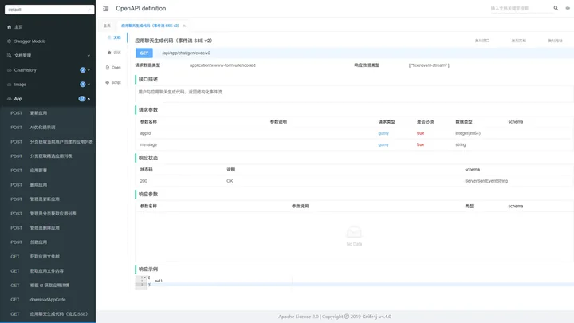
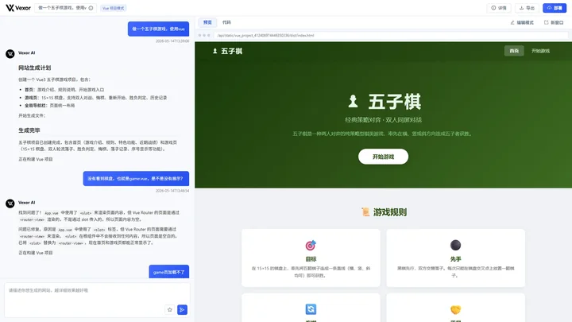
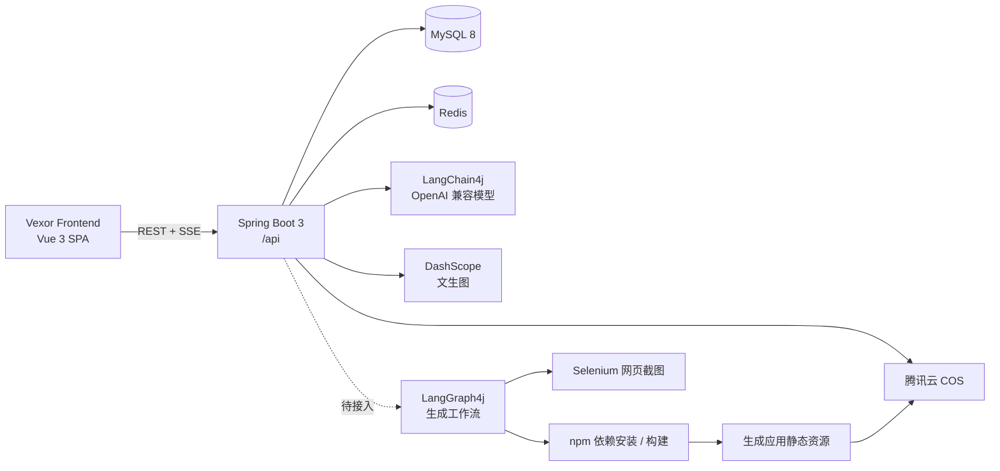
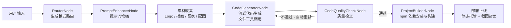

# Vexor Backend

**Vexor 零代码平台的 API 服务：AI 代码生成、应用构建与部署，内置 LangGraph4j 工作流模块。**

[](https://spring.io/projects/spring-boot)
[](https://openjdk.org)
[](https://docs.langchain4j.dev)
[](https://bschlageter.github.io/langgraph4j/)
[](https://www.mysql.com)
[](https://redis.io)

> [前端仓库](https://github.com/X1aoM1ngTX/zerocode-frontend)

Vexor Backend 基于 Spring Boot 3 + Java 21 构建，集成 LangChain4j 与 LangGraph4j，为前端提供 AI 代码生成、应用管理、聊天历史、项目构建部署等 API 服务。LangGraph4j 工作流模块已具备完整节点实现，但当前 V1/V2 生成入口仍由 `AiCodeGeneratorFacade` 直接编排。

**Knife4j API 文档**

[](docs/images/screenshots/api-docs.webp)

*启动后访问 `/api/doc.html` 查看全部接口*

**平台联调效果**

[](docs/images/screenshots/chat-preview.webp)

*前端通过 SSE 消费生成事件，右侧实时预览生成结果*

## 目录

- [技术栈](#技术栈)
- [系统架构](#系统架构)
- [代码生成链路](#代码生成链路)
- [项目结构](#项目结构)
- [快速开始](#快速开始)
- [配置说明](#配置说明)
- [核心功能](#核心功能)
- [API 一览](#api-一览)
- [开发指南](#开发指南)
- [部署](#部署)
- [测试](#测试)
- [常见问题](#常见问题)
- [安全注意事项](#安全注意事项)
- [贡献指南](#贡献指南)
- [许可证](#许可证)

## 技术栈

| 分类 | 技术 |
| --- | --- |
| 框架 | Spring Boot 3.5.8 · Java 21 |
| 数据库 | MySQL 8.0+ · MyBatis-Flex 1.11.0 · HikariCP |
| 缓存 / 会话 | Redis · Spring Session · Caffeine 本地缓存 |
| 分布式能力 | Redisson 3.50（接口限流） |
| AI | LangChain4j 1.1.0（OpenAI 兼容接口）· LangGraph4j 1.6.0-rc2 |
| 文生图 | 阿里云 DashScope SDK 2.22.1 |
| 网页截图 | Selenium 4.33.0 · WebDriverManager 6.3.3 |
| 云存储 | 腾讯云 COS 5.6.227 |
| API 文档 | Knife4j 4.4.0（OpenAPI 3） |
| 工具 | Hutool 5.8.38 · Lombok · Spring AOP |

## 系统架构



- **MySQL**：用户、应用、聊天历史等业务数据
- **Redis**：Spring Session、AI 聊天记忆、缓存与 Redisson 限流
- **COS / 本地静态目录**：生成应用的静态资源、封面截图与打包文件
- **LangChain4j**：对话、流式生成、智能路由、提示词增强等 AI Service；质检与素材规划 AI Service 位于 langgraph4j 模块

## 代码生成链路

### 四种生成模式

| 模式 | 枚举值 | 说明 |
| --- | --- | --- |
| 原生 HTML 模式 | `html` | 单文件 HTML 页面 |
| 原生多文件模式 | `multi_file` | 多文件静态站点 |
| Vue 工程模式 | `vue_project` | 完整 Vue 项目（自动 npm 构建） |
| React 工程模式 | `react_project` | 完整 React 项目（自动 npm 构建） |

由 `AiCodeGenTypeRoutingService` 根据用户需求自动路由，提示词位于 `src/main/resources/prompt/`。

### 当前主链路（V1 / V2）

- **V2（前端使用）**：`GET /api/app/chat/gen/code/v2` → `AppController.chatToGenCodeV2` → `AppService.chatToGenCodeV2` → `AiCodeGeneratorFacade.generateAndSaveCodeEventStream` → `Flux<AppGenerationMessage>` → SSE 命名事件。
- **V1（兼容）**：`GET /api/app/chat/gen/code` → `AppController.chatToGenCode` → `AppService.chatToGenCode` → `AiCodeGeneratorFacade.generateAndSaveCodeStream` → `StreamHandlerExecutor`（`SimpleTextStreamHandler` / `JsonMessageStreamHandler`）→ SSE `{ "d": chunk }` + `done`。

两条链路均由 `AiCodeGeneratorFacade` 直接编排，**当前没有调用 LangGraph4j 工作流**。

### LangGraph4j 工作流（已实现，尚未接入）



工作流代码已具备路由、提示词增强、素材收集、代码生成、质检与构建节点，但尚未接入 V1/V2 控制器入口；启用前需要显式接线并补充测试。

主要类：

- `langgraph4j/CodeGenWorkflow.java`：主工作流
- `langgraph4j/CodeGenConcurrentWorkflow.java`：并行素材收集工作流
- `langgraph4j/node/`：路由、提示词增强、生成、质检、构建等节点
- `langgraph4j/tools/`：Pexels 图片搜索、Logo 生成、Mermaid 图表、unDraw 插画
- `langgraph4j/state/WorkflowContext.java`：工作流上下文

## 项目结构

```text
src/main/java/com/xm/vexorbackend/
├── ai/                          # AI 代码生成
│   ├── guardrail/               #   输入安全拦截 / 输出校验重试
│   ├── model/message/           #   SSE 流式消息模型
│   ├── tools/                   #   AI 可调用的文件读写工具
│   ├── AiCodeGeneratorService.java
│   ├── AiCodeGenTypeRoutingService.java
│   ├── AppNameGeneratorService.java
│   └── PromptOptimizerService.java
├── langgraph4j/                 # LangGraph4j 工作流与素材能力（尚未接入主链路）
│   ├── CodeGenWorkflow.java
│   ├── CodeGenConcurrentWorkflow.java
│   ├── node/                    #   路由 / 增强 / 生成 / 质检 / 构建
│   ├── node/concurrent/         #   并行素材节点
│   ├── tools/                   #   图片搜索 / Logo / Mermaid / 插画
│   ├── ai/                      #   质检与素材规划 AI Service
│   └── state/                   #   WorkflowContext
├── core/                        # 核心处理链路
│   ├── AiCodeGeneratorFacade.java
│   ├── parser/                  #   HTML / 多文件解析器
│   ├── saver/                   #   代码文件保存器
│   ├── builder/                 #   Vue / React 项目构建
│   └── handler/                 #   SSE 流处理器
├── controller/                  # 用户 / 应用 / 对话 / 图像 / 静态资源 / 健康检查
├── service/                     # 业务服务与实现
├── mapper/                      # MyBatis-Flex Mapper
├── model/                       # 实体 / DTO / VO / 枚举
├── ratelimit/                   # @RateLimit + Redisson 限流
├── annotation/ + aop/           # @AuthCheck 权限注解与拦截器
├── config/                      # AI 模型 / Redis / COS / CORS / JSON
├── common/ + exception/         # 统一响应 / 业务异常 / 全局异常处理
├── manager/CosManager.java      # 腾讯云 COS 操作
├── generator/                   # MyBatis 代码生成器
└── VexorBackendApplication.java
```

资源文件：

```text
src/main/resources/
├── application.yml              # 主配置（端口 8123，context-path /api）
├── application-dev.yml          # 开发环境配置（不提交仓库）
├── application-dev-example.yml  # 开发环境配置示例
├── application-prod.yml         # 生产环境配置（不提交仓库）
├── application-prod-example.yml # 生产环境配置示例
├── prompt/                      # 各 AI 任务的系统提示词
├── sql/                         # 建表脚本（user / app / chat_history）
├── mapper/                      # MyBatis XML
└── logback-spring.xml           # 日志配置
```

## 快速开始

### 环境要求

- Java 21+
- MySQL 8.0+
- Redis 6.0+（聊天记忆依赖 RedisJSON，推荐 Redis Stack）
- Maven 3.6+（或使用项目自带 Maven Wrapper）
- Node.js 22+（Vue / React 工程模式构建需要）
- Chrome（Selenium 网页截图需要，WebDriverManager 自动管理驱动）

### 1. 初始化数据库

```sql
CREATE DATABASE zerocode CHARACTER SET utf8mb4 COLLATE utf8mb4_unicode_ci;
```

依次执行 `src/main/resources/sql/` 下的建表脚本：

- `create_user.sql`
- `create_app.sql`
- `create_chat_histoty.sql`

### 2. 创建环境配置

项目按 profile 区分环境（`application.yml` 默认激活 `dev`），环境配置文件不入库，需从示例复制：

```bash
cd src/main/resources
cp application-dev-example.yml application-dev.yml
```

### 3. 启动

```bash
# Maven Wrapper
./mvnw spring-boot:run

# 或本地 Maven
mvn spring-boot:run
```

服务启动于 <http://localhost:8123/api>，健康检查：<http://localhost:8123/api/health/>，API 文档：<http://localhost:8123/api/doc.html>。

## 配置说明

`application-dev.yml` 中需要填写的关键配置：

| 配置项 | 说明 |
| --- | --- |
| `spring.datasource.url` / `username` / `password` | MySQL 连接信息 |
| `spring.data.redis.host` / `port` / `password` | Redis 连接信息 |
| `xm.vexor.salt` | 用户密码加盐值 |
| `langchain4j.open-ai.chat-model` | 对话模型（OpenAI 兼容，要求 JSON 输出） |
| `langchain4j.open-ai.streaming-chat-model` | 流式对话模型 |
| `langchain4j.open-ai.reasoning-streaming-chat-model` | 推理模型（复杂任务） |
| `langchain4j.open-ai.routing-chat-model` | 智能路由模型（轻量分类） |
| `langchain4j.open-ai.prompt-optimizer-chat-model` | 提示词优化模型（返回纯文本） |
| `cos.client.host` / `region` / `bucket` / `secretId` / `secretKey` | 腾讯云 COS 配置 |
| `pexels.api-key` | Pexels 图片搜索 Key |
| `dashscope.api-key` / `image-model` | 阿里云百炼文生图配置 |
| `code.deploy-host` | 生成应用部署域名（用于拼接访问地址） |
| `knife4j.basic` | 生产环境 API 文档基础认证（可选） |

> `application-dev.yml` / `application-prod.yml` 含密钥，**不要提交到仓库**；分享配置结构时使用 `-example` 版本。

## 核心功能

### 1. AI 代码生成

- 四种生成模式，由智能路由自动选择
- LangChain4j AI Service + 流式模型，支持 Markdown / JSON / 文件块等多种输出格式
- 内置 `readFile`、`writeFile`、`modifyFile`、`deleteFile`、`readDir`、`exit` 等文件工具，AI 可直接操作项目目录
- 输入 Guardrail 拦截不安全提示词，输出 Guardrail 校验生成结果

### 2. LangGraph4j 工作流（已实现，尚未接入）

- 工作流模块已完成节点编排，但 V1/V2 控制器入口尚未调用；启用前需显式接线并补测试
- 提示词增强、素材收集、代码生成、质量检查、项目构建串成可恢复的工作流
- 质量检查不通过时自动回到生成节点重试
- 素材收集支持并行节点：Logo、插画、图表、配图分别执行后聚合
- `CodeGenConcurrentWorkflow` 使用并发节点缩短素材准备时间

### 3. 项目构建与部署

- `VueProjectBuilder` / `ReactProjectBuilder` 执行 npm 安装与构建
- `NpmBuildConcurrencyLimiter` 控制并发构建，避免机器资源被打满
- 部署后可通过 `StaticResourceController` 访问生成应用
- Selenium + WebDriverManager 自动截取页面封面，压缩后上传 COS
- `ProjectDownloadService` 支持将应用源码打包为 ZIP 下载

### 4. 用户、权限与限流

- 用户注册、登录、退出、个人资料查看与管理员 CRUD
- 基于 Spring Session + Redis 的会话（默认 30 天）
- `@AuthCheck` 注解 + AOP 校验管理员权限
- `@RateLimit` 注解 + Redisson 实现用户 / IP 维度限流
- 统一响应 `BaseResponse` 与全局异常处理

```java
// 管理员权限
@AuthCheck(mustRole = UserRoleEnum.ADMIN)

// 用户维度限流：60 秒内最多 10 次
@RateLimit(limitType = RateLimitType.USER, rate = 10, rateInterval = 60)
```

### 5. 聊天历史与 AI 记忆

- `chat_history` 表持久化用户与 AI 的对话
- 支持按应用分页查询历史消息
- Redis 保存 AI 聊天记忆，生成时自动携带上下文
- 消息类型区分用户输入与 AI 回复

### 6. AI 图像生成

`ImageController` 调用 DashScope SDK，支持正向/负向提示词、分辨率、随机种子等参数；前端「图像生成」页面直接消费该接口。

### 7. 缓存与静态资源

- Caffeine 缓存 AI Service 实例，避免每次请求重复创建
- Redis 作为 Spring Cache 存储，缓存精选应用分页等热点数据
- 生成应用静态资源通过 `/api/static/**` 暴露
- 已部署应用支持按 `deployKey` 访问

## API 一览

### 用户

| 方法 | 路径 | 说明 |
| --- | --- | --- |
| POST | `/api/user/register` | 注册 |
| POST | `/api/user/login` | 登录 |
| POST | `/api/user/logout` | 退出登录 |
| GET | `/api/user/get/login` | 获取当前登录用户 |
| GET | `/api/user/get` | 按 id 获取用户公开信息 |
| POST | `/api/user/admin/add` | 新增用户（管理员） |
| GET | `/api/user/admin/get` | 查询用户（管理员） |
| POST | `/api/user/admin/list/users` | 分页用户列表（管理员） |
| POST | `/api/user/admin/update` | 更新用户（管理员） |
| POST | `/api/user/admin/delete` | 删除用户（管理员） |

### 应用与 AI 生成

| 方法 | 路径 | 说明 |
| --- | --- | --- |
| POST | `/api/app/add` | 创建应用 |
| POST | `/api/app/optimize-prompt` | AI 优化提示词 |
| POST | `/api/app/update` | 更新应用 |
| POST | `/api/app/delete` | 删除应用 |
| GET | `/api/app/get/app` | 应用详情 |
| POST | `/api/app/list/my-apps` | 我的应用（分页） |
| POST | `/api/app/list/good-apps` | 精选应用（分页） |
| GET | `/api/app/chat/gen/code` | AI 对话生成代码（SSE，V1） |
| GET | `/api/app/chat/gen/code/v2` | AI 对话生成代码（SSE，V2，前端使用） |
| GET | `/api/app/{appId}/files` | 应用文件树 |
| GET | `/api/app/{appId}/files/content` | 应用文件内容 |
| POST | `/api/app/deploy` | 部署应用 |
| GET | `/api/app/download/{appId}` | 打包下载源码 |
| POST | `/api/app/admin/list/apps` | 分页应用列表（管理员） |
| GET | `/api/app/admin/get/app` | 应用详情（管理员） |
| POST | `/api/app/admin/update` | 更新应用（管理员） |
| POST | `/api/app/admin/delete` | 删除应用（管理员） |

### 其他

| 方法 | 路径 | 说明 |
| --- | --- | --- |
| GET | `/api/chatHistory/app/{appId}` | 应用聊天历史 |
| POST | `/api/chatHistory/admin/list/page/vo` | 分页对话列表（管理员） |
| POST | `/api/image/generate` | AI 文生图 |
| GET | `/api/health/` | 健康检查 |
| GET | `/api/static/{deployKey}/**` | 已部署应用静态资源 |

完整接口、参数与响应结构以 [Knife4j 文档](http://localhost:8123/api/doc.html) 为准。

## 开发指南

### 添加新功能

1. `model/entity` 创建实体 → `generator/MyBatisCodeGenerator` 生成 Mapper
2. `model/dto`、`model/vo` 定义传输对象
3. `service` + `service/impl` 实现业务
4. `controller` 暴露接口，权限用 `@AuthCheck`，限流用 `@RateLimit`

### 异常处理

```java
// 抛出业务异常
throw new BusinessException(ErrorCode.PARAMS_ERROR, "参数错误");

// 断言式工具
ThrowUtils.throwIf(condition, ErrorCode.PARAMS_ERROR, "错误信息");
```

返回给前端的错误信息统一使用中文，由 `GlobalExceptionHandler` 转换为 `BaseResponse`。

### AI Service 与提示词

- AI 接口使用 LangChain4j 的声明式 `AiService`，按任务拆分：生成、路由、提示词优化、名称生成、质检、素材规划
- 系统提示词集中放在 `src/main/resources/prompt/`
- 不同任务使用不同模型：复杂生成用推理模型，路由/优化用轻量模型，降低成本与延迟

### 流式事件约定

`/api/app/chat/gen/code/v2` 通过 `text/event-stream` 返回事件，前端按消息类型处理：

- AI 文本增量
- 工具请求 / 工具执行结果
- 生成完成 / 预览就绪
- 错误与结束事件

调整事件格式时需同步更新前端的 `AppChatPage` 与 `StreamMessage` 模型。

## 部署

### 打包

```bash
./mvnw clean package
```

### 运行

```bash
java -jar target/vexor-backend-0.0.1-SNAPSHOT.jar --spring.profiles.active=prod
```

仓库根目录提供 `start.sh` / `stop.sh`：

- 若服务器安装了 `vexor-backend.service`，脚本优先通过 systemd 启动
- 否则使用 `nohup` 后台运行，日志写入 `app.log`

### Docker 示例

```dockerfile
FROM eclipse-temurin:21-jdk-slim

# Vue / React 工程模式需要 Node.js 22+ 与 npm；
# 网页截图还需要 Chrome / Chromium（可由 WebDriverManager 管理驱动）。
# 请按基础镜像的发行版自行安装上述运行时。

COPY target/vexor-backend-0.0.1-SNAPSHOT.jar app.jar
EXPOSE 8123
ENTRYPOINT ["java", "-jar", "/app.jar", "--spring.profiles.active=prod"]
```

> 生产镜像必须包含 Node.js / npm，否则 Vue、React 工程模式无法构建；Selenium 截图还需要可用的 Chrome 与驱动。

## 测试

```bash
./mvnw test
```

测试用例位于 `src/test/java/`；测试目录沿用历史包名 `com.xm.zerocodebackend`。

## 常见问题

- **数据库连接失败**：确认 MySQL 已启动、`zerocode` 数据库存在、字符集为 utf8mb4。
- **Redis 连接失败**：检查 `spring.data.redis` 配置；Redisson 与会话都依赖 Redis。
- **AI 生成失败 / 超时**：检查模型 base-url、api-key 与额度；流式模型默认超时 4 分钟。
- **Vue / React 构建失败**：确认服务器已安装 Node.js 与 npm；构建并发由 `NpmBuildConcurrencyLimiter` 控制。
- **截图 / 图片搜索不可用**：确认 Chrome 可用、Pexels Key 已配置。
- **文件上传失败**：检查腾讯云 COS 配置与存储桶权限。
- **API 文档无法访问**：确认服务启动成功，并访问 `http://localhost:8123/api/doc.html`。

## 安全注意事项

- 环境配置文件含密钥，不要提交到仓库；使用 `-example` 版本分享结构
- 用户密码使用加盐哈希存储，盐值通过 `xm.vexor.salt` 配置
- 管理接口必须加 `@AuthCheck`，敏感接口建议叠加 `@RateLimit`
- 生成项目由 AI 产出，部署前建议增加代码审查与安全扫描
- COS 密钥、模型 Key 建议使用环境变量或密钥管理服务注入

## 贡献指南

1. Fork 本仓库
2. 创建特性分支（`git checkout -b feature/AmazingFeature`）
3. 提交更改（`git commit -m 'feat: add some AmazingFeature'`）
4. 推送到分支（`git push origin feature/AmazingFeature`）
5. 开启 Pull Request

## 许可证

本项目采用 MIT 许可证发布。
